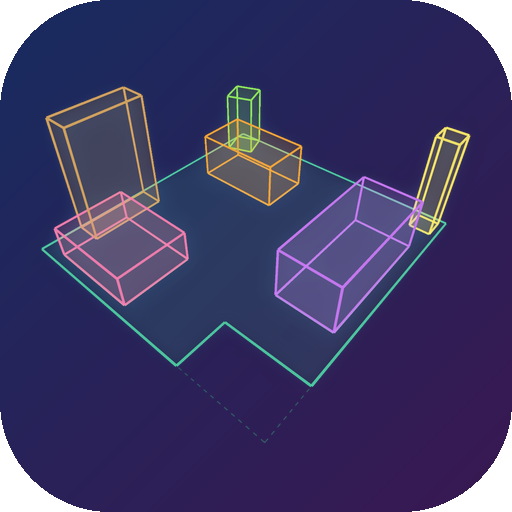
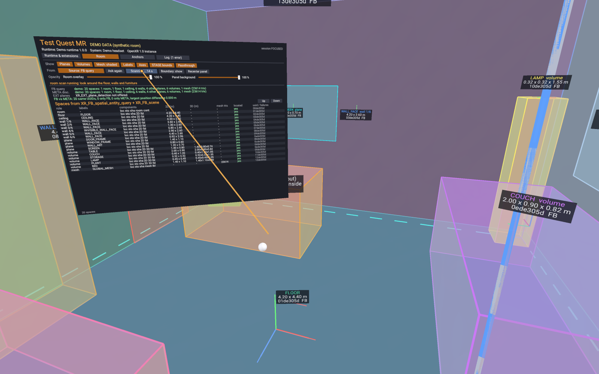
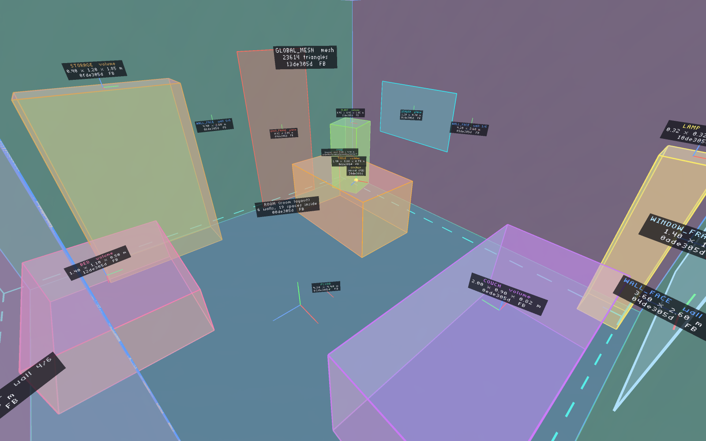
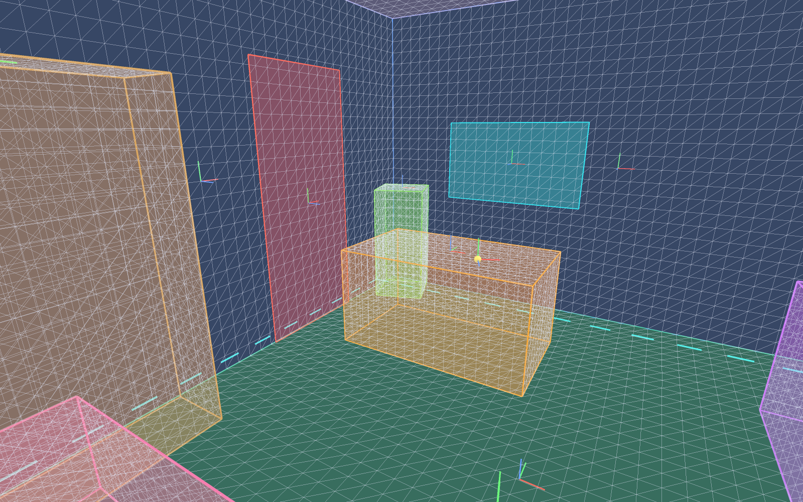
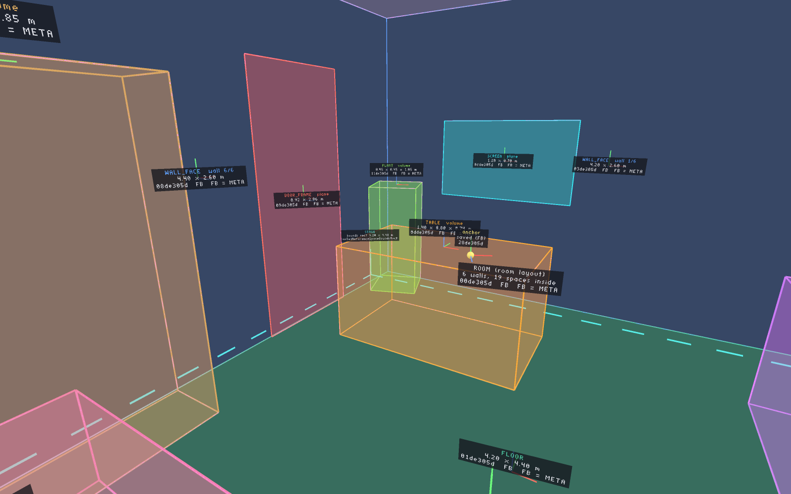
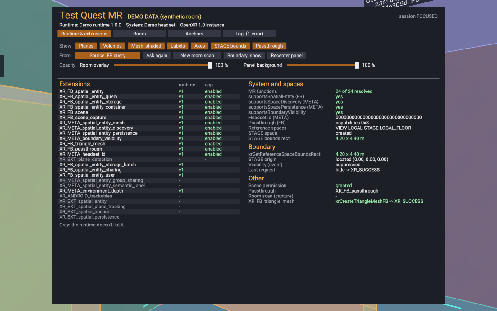
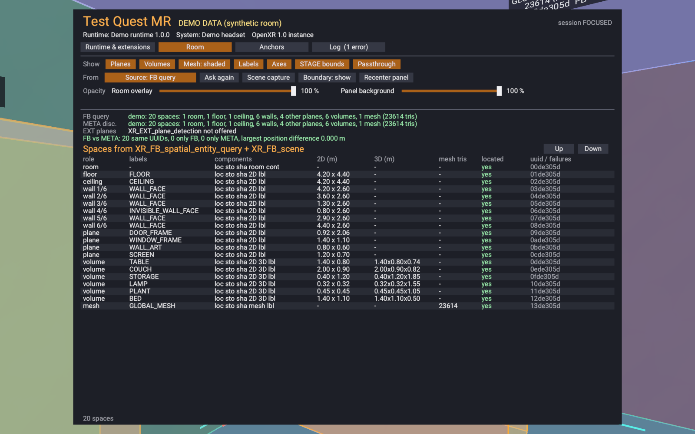
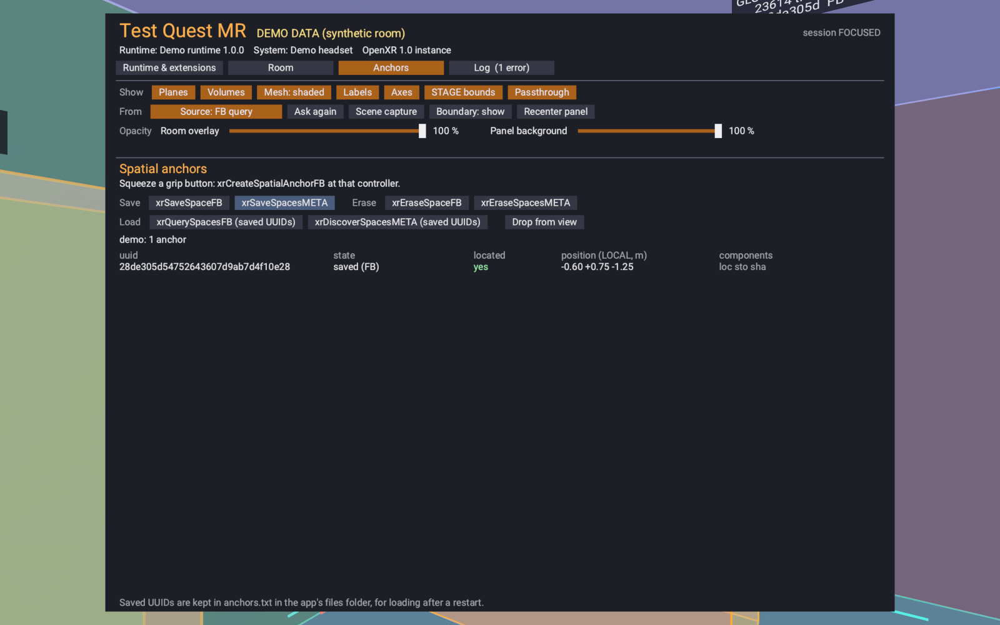
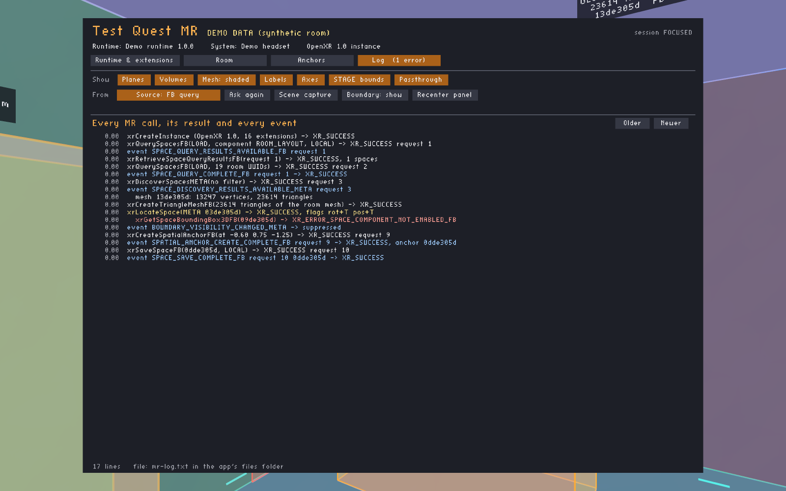
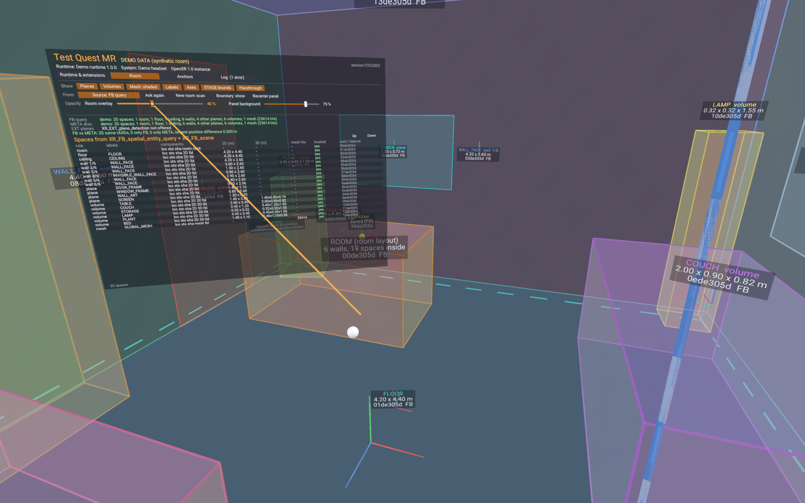

<p align="center"></p>

# Test Quest MR

[](https://frameport.app/install?manifest=https%3A%2F%2Fraw.githubusercontent.com%2Fspoopyghosty0%2FTestQuestMR%2Fmain%2Fframeport-install.json)

See what your headset's runtime delivers through the Meta mixed-reality APIs: the room, its planes and furniture,
the room mesh, anchors and the boundary, drawn over passthrough where the runtime puts them, each labelled with the
API that produced it.

Steam Frame: use the button (needs [FramePort](https://frameport.app)). Quest: sideload the APK from
[Releases](https://github.com/spoopyghosty0/TestQuestMR/releases/latest).



| | |
|---|---|
|  Planes, volumes and the STAGE bounds |  The room mesh as a wireframe |
|  FB query and META discovery compared |  Extensions, system properties, boundary |
|  Every space with its components |  Anchors: save, erase, load (FB and META) |
|  Every call, its result and every event |  The overlay faded to 40 %, the panel to 75 % |

<sub>Screenshots: the PC renderer with a made-up demo room, not a real headset.</sub>

## What it shows

- **Runtime:** which MR extensions the runtime lists and the app enabled, system properties (spatial entities,
  discovery, persistence, boundary visibility, headset id), reference spaces, the STAGE bounds rect (or
  `XR_SPACE_BOUNDS_UNAVAILABLE`), the scene permission.
- **Room, FB path:** `xrQuerySpacesFB` for the room (`ROOM_LAYOUT`), then its contents by UUID; per space the
  components, semantic labels, `BOUNDED_2D` rect and outline, `BOUNDED_3D` box, room layout (floor, ceiling, walls in
  order), container, mesh. Planes are translucent with their outline, volumes are boxes, axes mark each pose.
- **Room, META path:** the same through `xrDiscoverSpacesMETA`. *Source* switches FB / META / both (labels then say
  whether the two agree) / EXT plane detection (if offered).
- **Room mesh:** `XR_META_spatial_entity_mesh`, shaded or wireframe, handed back through `xrCreateTriangleMeshFB`.
- **Boundary:** the STAGE bounds on the floor; hide or show the guardian with `XR_META_boundary_visibility`.
- **Anchors:** squeeze a grip to place one; save, erase and load through `xrSaveSpaceFB` / `xrSaveSpacesMETA`,
  `xrEraseSpaceFB` / `xrEraseSpacesMETA`, `xrQuerySpacesFB` / `xrDiscoverSpacesMETA`.
- **New room scan:** `xrRequestSceneCaptureFB` (Quest: Space Setup; Steam Frame with FramePort: a headset room scan), shows the scan running, then asks for the room again.
- **Log:** every call and event, also in logcat (tag `TQMR`) and in `mr-log.txt` in the app's files folder
  (`Android/data/io.github.spoopyghosty0.testquestmr/files`), next to `room-fb.txt` / `room-meta.txt` (what each
  path returned).

Point at the panel and pull the trigger; the thumbstick scrolls lists. The *Opacity* sliders (hold the trigger and
drag, or point at one and push the thumbstick sideways for 5 % steps) fade the room visualisation, to compare it with
the real room (fills and the mesh fade out completely, outlines and label plates keep a faint minimum), and the panel's
background; both are kept in `settings.txt`. The panel is its own quad layer, rendered at 2 texels per layout unit
with the system font (Roboto), so its text stays sharp. A file named `demo` in the files folder shows
the demo room instead of the runtime's.

## Build

```
./gradlew assembleRelease
```

PC preview (Mesa): `cmake -S tools/render_host -B out/render_host && cmake --build out/render_host`, then
`python3 tools/screenshots.py` and `python3 tools/gen_icon.py`.

Releases: tag `vX.Y.Z` matching `versionName` in `app/build.gradle.kts`.

## Licence

MIT. Not affiliated with Meta.
